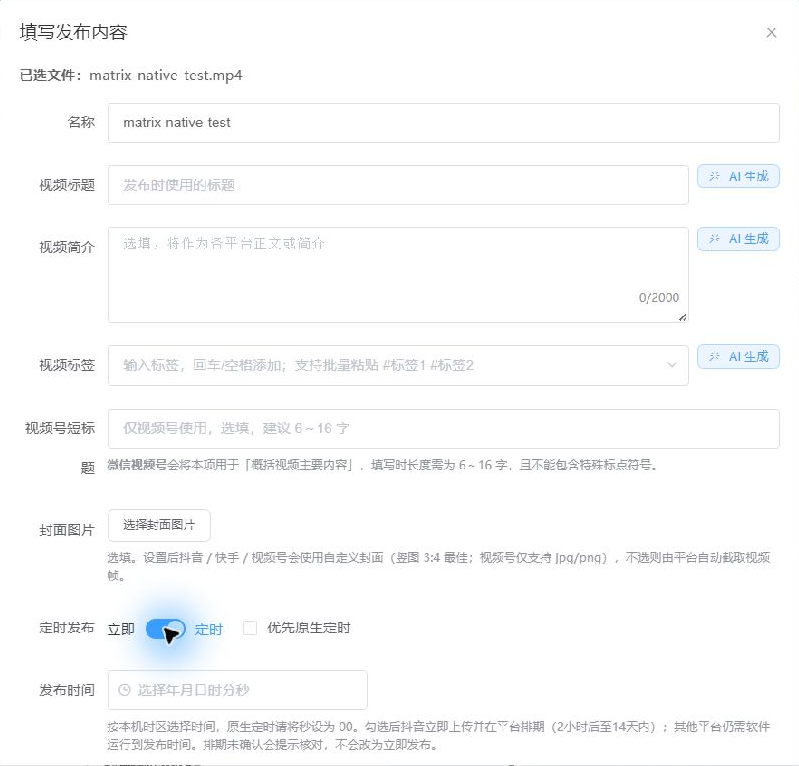

# 抖音和视频号原生定时验证记录

验证日期：2026-11-21 至 23（北京时间）。关联 #40。抖音和视频号均已接入；视频号平台实测仍不完整，保留草稿 PR。

已跟进上游 `c945d68`；保留新增的视频预览、拖拽、商品挂载和回执诊断。

## 实现范围

- GUI 单视频、目录批量入口增加「优先原生定时」，CLI / HTTP / MCP 同步透传。
- 抖音和视频号立即上传并填写平台排期，其他平台和未勾选场景保留软件定时。
- 输入按本机时区解析，两个平台使用北京时间与分钟精度。抖音支持 2 小时后至 14 天内；视频号以平台选择器为准。
- `native_scheduled` 只表示平台接收了排期，不表示审核通过或最终公开。原生任务不进入本地到期发布调度。
- 结果不明返回退出码 4；跨进程占位记录阻止同账号、素材、时刻的自动重复上传。
- 同素材转为立即发布或草稿时显式清空旧原生排期字段，避免历史合并后误用上次时间。
- 「获取状态」的普通标题匹配缺少排期及公开状态证据，因此原生排期记录不走该匹配，避免将尚未公开的作品改为成功。

## 真实平台证据及边界

### 原生提交与只读复核

使用自行生成的 6 秒彩色视频，在已授权抖音账号提交了一条北京时间 **2026-11-22 12:00** 的原生排期。

首次 CLI 提交已经点击发布，但旧校验依赖后台「定时发布」文案；实际新后台显示未来日期与审核状态，因此该次返回：

```json
{"status":false,"resultStatus":"needs_attention","nativeScheduleVerified":false,"publishAt":"2026-11-22 12:00:00"}
```

退出码为 **4**，没有将不明结果报告为成功。随后改为读取管理页实际触发的 `work_list` 响应，用修复后的源码对**同一条已提交作品只读复核**：

```json
{"verified":true,"baselineContainsExisting":true,"excludedOldRecord":true,"readOnly":true}
```

判据为成功列表响应中的字符串 `aweme_id`、标题、`timer.public_time`、本次观测到的 `timer.status=0` 及未删除/禁用标志。提交前列表快照中的旧 ID 必须排除。没有把 JSON number 类型的大整数 `item_id` 用作精确 ID。

11 月 23 日在抖音管理页按作品 ID 与标题复核，该作品显示「已发布」。随后通过「设置权限」改为「仅自己可见」，刷新管理页后确认该作品的私密状态生效。**修复后的完整原生 CLI 成功链路没有再次提交。** 账号、作品 ID、Cookie、原始响应及素材不随代码上传。

### 视频号控件实测与阻塞

- 登录鉴权返回成功。在视频号助手真实发表页添加同一测试素材，使用源码的日期、时分选择器适配器，回读到「定时」已选中及北京时间 `2026-11-24 12:35`。没有点击发表。
- 平台自己的 `helper_upload_params` 和 `post_list` 返回 `errCode=300002`（`request failed`）。上传停在 0%，作品管理页的空提示也不能当作成功读取。客户端提交前遇到列表失败会停止。
- 同日用 Edge 打开官方视频号助手，当前扫码的微信收到「没有可登录的视频号」。暂无其他具备运营权限的测试账号；无法继续验证草稿或原生发表。该提示是独立观察，不能据此把 `300002` 一概解释为权限问题。
- 原生排期的作品列表预检会报告平台错误码、登录失效或跳转登录页，并提示先确认能在助手中打开作品管理。列表读取失败时不会开始上传或确认排期。
- 按仓库流程重跑 `node e2e/run.js -p sph --yes --force --skip-build --phone <授权账号> --video <测试视频> --timeout 90`。run `20261123-120352` 超时，诊断为 `[sph][mark-tag] 已选择：含AI生成内容`，没有获得 `draftVerified` 或确认草稿已保存。没有提交视频号排期。
- 视频号适配器在点击前再次检查模式、时间和按钮；只认成功管理列表中的新作品 ID、实际文案、创建时间和未来的 `effectiveTime`。这些字段参考提供该列表的官方页面实现；成功响应的字段与整个排期流程仍需账号实测。

### CLI / MCP 防重

在确认同一任务已有提交记录后，分别通过真实 Electron CLI、MCP SDK stdio 调用 `publish_video` 重试同一请求。两次均在上传前被防重记录拦截：

```text
CLI: resultStatus=needs_attention, nativeScheduleVerified=false, exit=4
MCP: status=needs_attention, nativeScheduleVerified=false
message: 同一账号、文件和时间的原生排期已有提交记录，未重复上传。
```

这两项证据覆盖真实防重分支，**不等同于 MCP 或 CLI 的完整成功排期验证**。

### GUI

实际启动构建产物，通过系统文件选择器选中测试素材并打开单视频表单，切换为定时后确认「优先原生定时」、时间输入及说明可见。截图仅保留该表单：



另打开目录批量表单，切换为定时、勾选「优先原生定时」，确认控件可切换、时间输入及范围说明可见；完成后取消表单，没有选择目录或提交任务：


GUI 尚未执行原生提交；目录批量上传及路由由下述脚本覆盖。GUI / CLI / MCP 完整正向原生链路尚不满足合并验收，当前适合作为草稿审阅。

## 构建与回归

环境：Windows、Node 20.20.2。已执行 `yarn build:dir`。接入视频号后重跑原生定时、服务、目录批量、防重、发布控制流及视频号挂载等 12 个相关脚本，均通过；其中 `test-sph-native-schedule.js` 覆盖定时模式失效禁点、旧作品排除和列表错误。

以下脚本已通过（`node scripts/test-<名称>.js`）：

```text
dy-native-schedule       native-schedule-guard
native-schedule         native-schedule-service
native-schedule-batch   puppeteer-cancel
publish-abnormal        product-publish-gates
xhs-publish-policy      scheduled-publish
history-status          history-args
publish-history-csv     publish-draft-args
dy-description          scheduled-dedupe
pushdata-dedupe
get-status-sets-publish-status  dy-ks-link-options
```

`yarn --cwd mcp build` 通过；`node --test mcp/tests/nativeSchedule.test.mjs` **5/5 通过**（CLI 替身，覆盖两平台参数与回执）。未将 MCP 全量测试报告为通过：其 Windows shebang 测试夹具存在 `ENOENT`，本次未修复。补充视频号列表诊断后，主进程、渲染进程和 MCP 重新构建成功，原生排期、草稿参数、发布异常及挂载门控共 9 个脚本与上述 5 项 MCP 契约测试均通过。

附加尝试的 `product-customer-dom` 因本机没有外置 Playwright 而启动失败（`MODULE_NOT_FOUND`）；`ks-customer-dom` 未运行。这两项不计入通过。上游合并后的 `product-publish-gates` 已通过 26 个 handler 场景及重试范围检查。

真实草稿 e2e 使用明确构建后再运行的方式（Windows 上 runner 自动调用 yarn 失败，所以使用 `--skip-build`）：

```text
yarn build:dir
node e2e/run.js -p dy --yes --force --skip-build --phone <已授权账号> --video <测试视频绝对路径>
```

最新源码验证 run `20261121-094507`（已合入上游 `c945d68`）：构建成功，`PASS_VERIFIED`、退出码 **0**、`draftVerified=true`。实际诊断：

```text
[dy] 已点击存草稿按钮 (#popover-tip-container+button)
[publish] 抖音 存草稿后页面地址已变化（草稿模式仅记录，不判定异常）
[publish] 抖音 已确认草稿保存成功（页面已跳转）
```

这使用现有 runner 的页面跳转判据；未人工在平台后台找到该草稿，不代表原生定时成功。此次复测还确认历史为 `scheduleMode=immediate`、`nativeScheduleAt=null`、`nativeScheduleVerified=false`、`scheduledPublishAt=null`、`scheduledTask=false`，旧排期字段已清空。

## 审阅状态

本补丁由 **OpenAI Codex** 辅助实现和测试。#40 需要两平台通过验收。GUI、CLI、MCP 的完整正向覆盖仍未满足验收。

视频号复测需要能打开视频号助手「作品管理」的账号。登录后先重跑草稿 e2e，要求退出码 0 且 `draftVerified=true`。再用带唯一测试标记的素材提交远期原生排期，要求回执为 `native_scheduled`、`nativeScheduleVerified=true`，并在后台确认北京时间一致。核验后撤回排期，刷新列表确认；记录脱敏的运行结果即可。
